# Pixel Invader — UX review and proposal (apps/web)

Scope: design review only; no app code changed. Evidence: Playwright captures of the dev build (`pnpm dev`) with `test-fixtures/selfie.png` at 1440×900, 1280×720, 820×1180 (tablet) and 390×844 (phone), stored in [`screenshots/`](screenshots/) (59 files, `<viewport>-<NN>-<state>.png`). Code references are to `apps/web/src`. Priorities from the user: **a clean UI and an excellent workflow**, keeping the retro / ZX-Spectrum identity.

Intended core flow: **load image → choose target → convert → inspect → export.**

## 1. Summary

The app is capable and fast (a 512×512 selfie converts in ~0.35 s; no console errors in any state), but the UI exposes the *workbench* (dockable windows, every setting) before the *workflow*. Top findings:

1. **Empty state has no call to action.** The first screen is a checkerboard, a black box and a one-line hint; the only way to load an image is File ▸ Open Image… (`⌘O`). (F1)
2. **Target choice is not a first-class step.** Profile/mode appear as a read-only breadcrumb top-right; changing it means Convert ▸ … menu or Settings ▸ Startup. (F2)
3. **Settings are a wall of collapsed panels, then tiny scroll boxes.** Five collapsed sections (Tools, Geometry, Image adjustments, ZX palette, Dithering); opening them yields ~220 px-high scroll areas inside a docked window, and the result preview rescales unpredictably when they open. 65 registry settings have no basic/advanced split. (F3, F4)
4. **Responsive is broken.** At 820 px and 390 px the page overflows horizontally (`scrollWidth` 1601 / 1299 px), toolbar buttons become full-width blobs, the status line is clipped. At 1280×720 the whole page scrolls vertically (861 px), so the menu bar scrolls away and Convert sits below the fold. (F6)
5. **Feedback is thin and low-contrast.** Window titles ("Conversion input", "ZX Spectrum result") are dark text on a dark bar; the open "File" menu trigger renders with no visible label; status is one truncated mono line. (F5, F7)
6. **Export is buried** in File ▸ Export (5 items) with no visible button after converting. (F8)

**Recommendation:** keep the dockable workbench as the *Advanced* mode, but make the default a **"Guided" layout**: a 5-step workflow bar (Image · Target · Convert · Inspect · Export), a single large source/result comparison stage, and one right-hand settings sidebar with **Basic / Advanced / Expert** tiers driven by the existing registry (Option B below, mockup in [`mockups/recommended-layout.html`](mockups/recommended-layout.html)). Ship it incrementally in 10 small steps (§6), starting with zero-risk fixes (contrast, empty state, responsive overflow).

## 2. Flow audit (current state)

| Step | Current path | Clicks | Notes |
| --- | --- | --- | --- |
| Load image | File ▸ Open Image… / `⌘O`; Import from Clipboard also in File | 2 (no on-canvas button) | Drag-and-drop/paste not advertised (F1). Large-image import is non-blocking (smoke test heartbeat). |
| Choose target | Breadcrumb is display-only; change via Convert menu or Settings ▸ Startup | 2–4 | Mode labels in `workbench-menu-bar.tsx` (`HARDWARE_MODE_LABELS`) are good but hidden. Default is ZX48 standard — OK for the common case. |
| Convert | Draft auto-updates; **Convert High** button bottom-left of the settings area | 1 | Name "High" is jargon; Draft vs Final relationship only explained by "Stale · press Convert High" (`result-comparison-dock.tsx`). No `⌘Enter`. |
| Inspect | Source/Result windows with content `<select>` (8 options each), zoom ±/%/fit per window, pan/zoom sync toggles hidden in the Tools section | 1–3 | Before/after is side-by-side only; no swipe/flip/difference toggle at top level (difference lives inside the content dropdown). |
| Export | File ▸ Export ▸ PNG / GIF / Binary / Metadata / Inspection JSON | 2 | No primary "Export" action; format meaning unexplained. |

Happy path today: **Open Image (2) + Convert High (1) + Export (2) = ~5 clicks** — short, but only because the user already knows where things are. First-time discoverability is the problem, not click count.

## 3. Findings (annotated)

Impact: H/M/L. Effort: S (<½ day), M (≈1 session), L (multi-session).

### F1 — Empty state lacks a call to action (H / S)
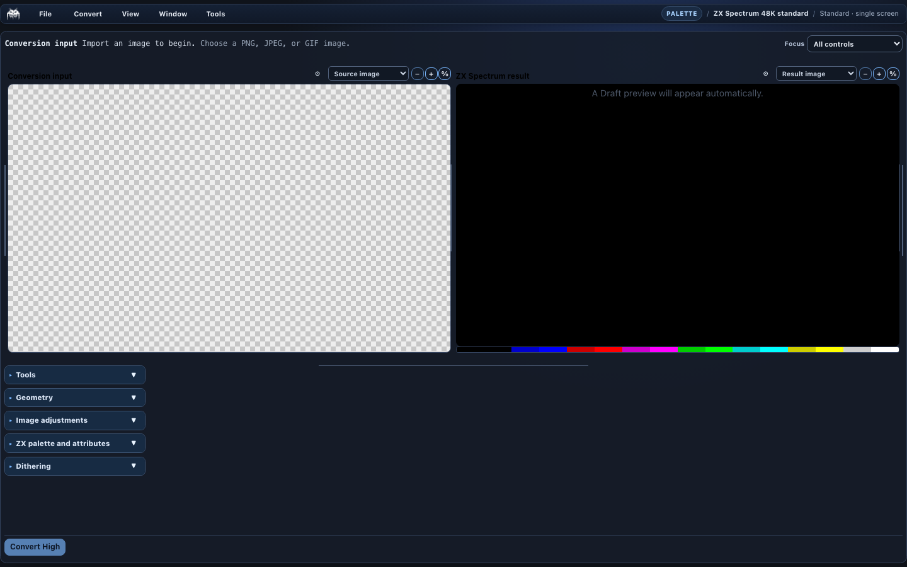
- Checkerboard looks like a transparent image already loaded; "Import an image to begin." is tiny mono text in the top status row, and the result panel says "A Draft preview will appear automatically." in dark grey on black.
- Fix: centred drop zone in the source window ("Drop an image, paste, or Open…"), sample-image link (`test-fixtures/selfie.png` equivalent), accepted types and size hints; hide the checkerboard until an image exists; replace result text with a muted placeholder that explains *what will appear* ("Result appears here after you load an image").
- Phone/tablet equivalents: [tablet](screenshots/tablet-01-empty.png), [phone](screenshots/phone-01-empty.png).

### F2 — Target selection is a read-only breadcrumb (H / M)
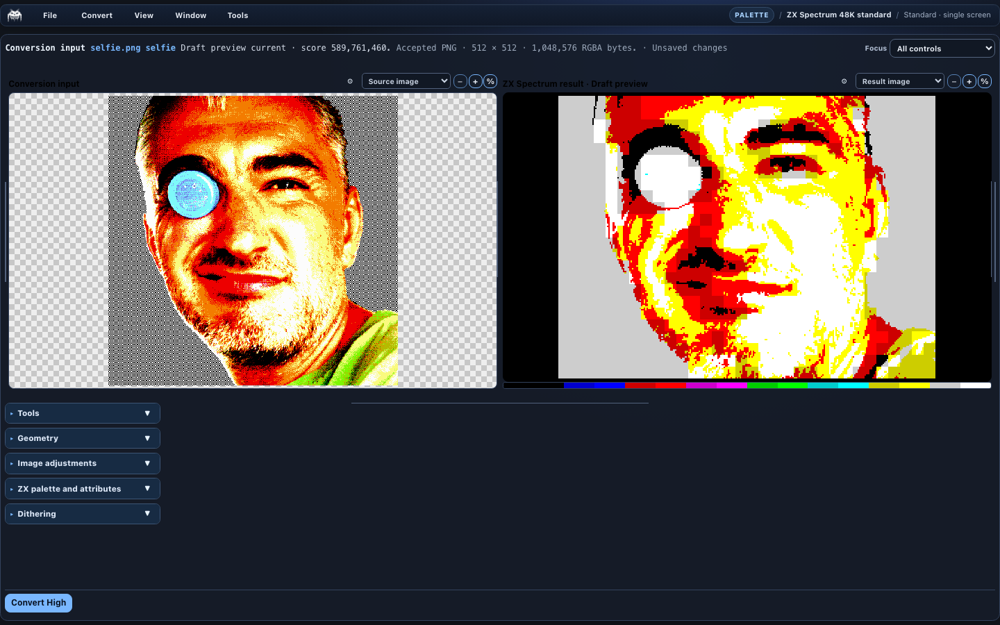
- `PALETTE / ZX Spectrum 48K standard / Standard · single screen` looks like a title, not controls. Profile, preset and hardware mode live in Convert menu and Settings ▸ Startup.
- Fix: make it two real selects (Target, Preset) in a workflow bar; keep the breadcrumb style as a read-only summary elsewhere.

### F3 — Settings panels: collapsed list, then cramped scrolling (H / M)
 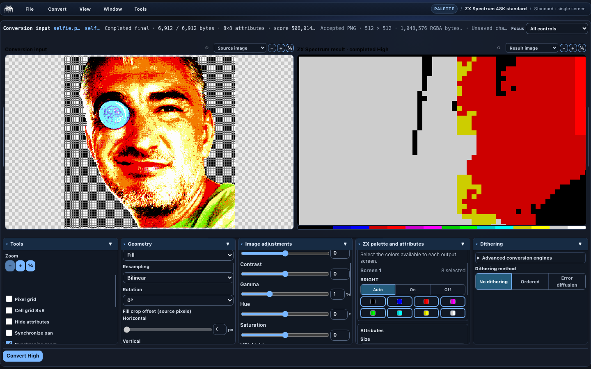
- Collapsed state wastes ~60 % of the screen: five 220 px buttons with an unexplained `▼` (the `▸` and `▼` glyphs disagree), then empty space.
- Expanded state: sections become five side-by-side windows with ~250 px-tall internal scrolling (Geometry shows 3 of 8 controls; Tools checkboxes are cut off). Focus presets ([Geometry](screenshots/desktop-07-focus-geometry.png), [Dithering](screenshots/desktop-07-focus-dithering-controls.png)) help but live in an unlabeled `Focus` select.
- Opening a section shrinks the preview area and the result view re-fits to a different zoom than the source (compare source/result in the open screenshot) — zoom/pan feel inconsistent although "Synchronize zoom" exists (default off in the Tools window, default **on** in registry; see Q4).
- Fix: one scrollable sidebar with tiers (§5), sticky Convert, preview area fixed in size.

### F4 — Settings registry has no importance tiers (H / M)
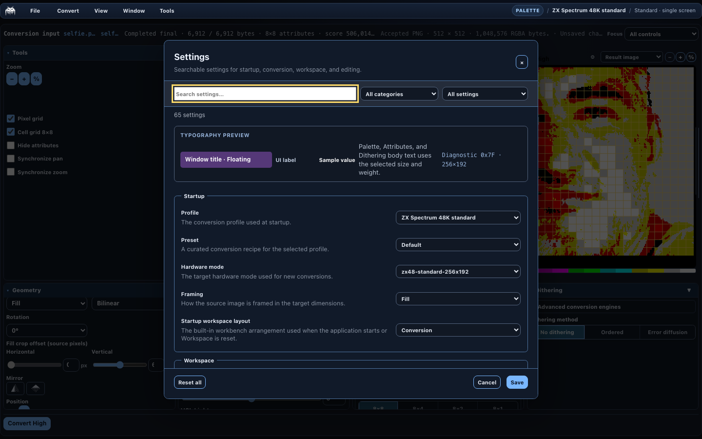
- `settings-registry.ts` defines ~65 settings in 9 categories (geometry 15, palette 14, dithering 10, adjustments 6, appearance 7, startup 5, export 4, workspace 3, mouse 1) with `presets` tags (`conversion-quality` etc.) but no `level`. Application Settings starts with a typography preview and 5 startup items; the modal body scroll hides everything else, and *conversion* settings (scope `conversion`) are mixed with *application* ones (scope `application`).
- Good: search, "Modified" preset, per-setting descriptions, disabled reasons (`disabledReason`) — keep all of them.
- Fix: add `level: "basic" | "advanced" | "expert"` to `SettingDefinition` and render the sidebar from it (§5). Dev-only items (benchmarks, comparison; `developmentMode`) become Expert.

### F5 — Feedback during conversion and after (M / S–M)
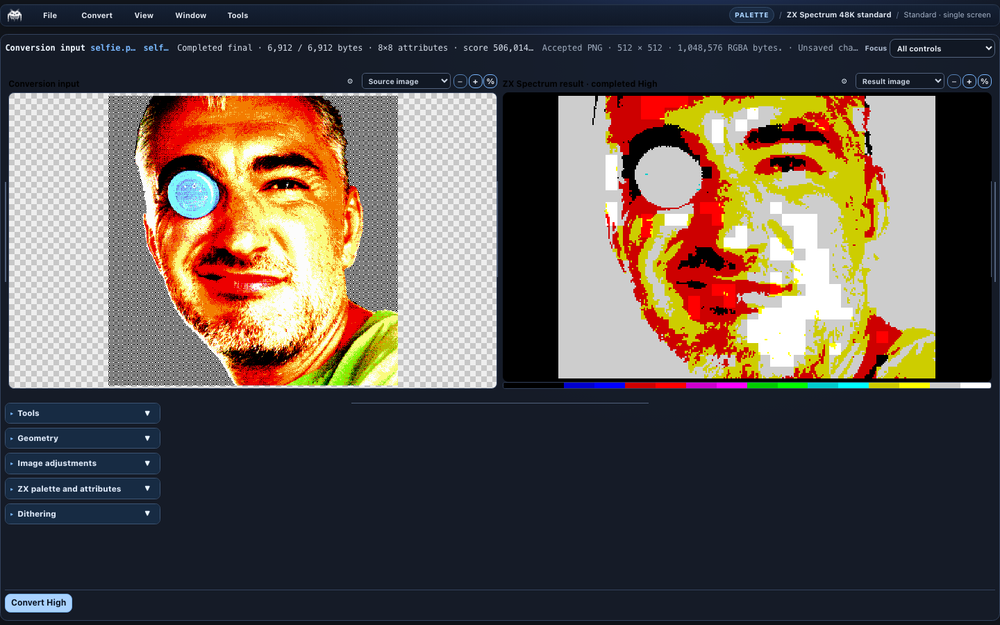
- Conversion of the sample is ~0.35 s, so the "Converting…" state is almost never visible; for big targets/engines it will be. There *is* a Cancel (`Cancel High` in `App.tsx`) but it only appears next to the button that has left the sight line, and there is no progress value, only a label swap.
- Result: status is one truncated line (`Completed final · 6,912 / 6,912 bytes · 8×8 attributes · score 506,014…  Accepted PNG · 512 × 512 · 1,048,576 RGBA bytes. · Unsaved cha…`) mixing import, conversion and project state; `score 506,014` is unexplained.
- Errors/empty: no visible error banner states were reachable in the smoke walk; recommend explicit design for unsupported file, oversized file, worker failure, cancelled conversion.
- Fix: footer status bar with three zones (result summary · progress+Cancel · project state), `aria-live="polite"` (already present on some regions), explain/lose "score" for Basic.

### F6 — Responsive layout (H / M)
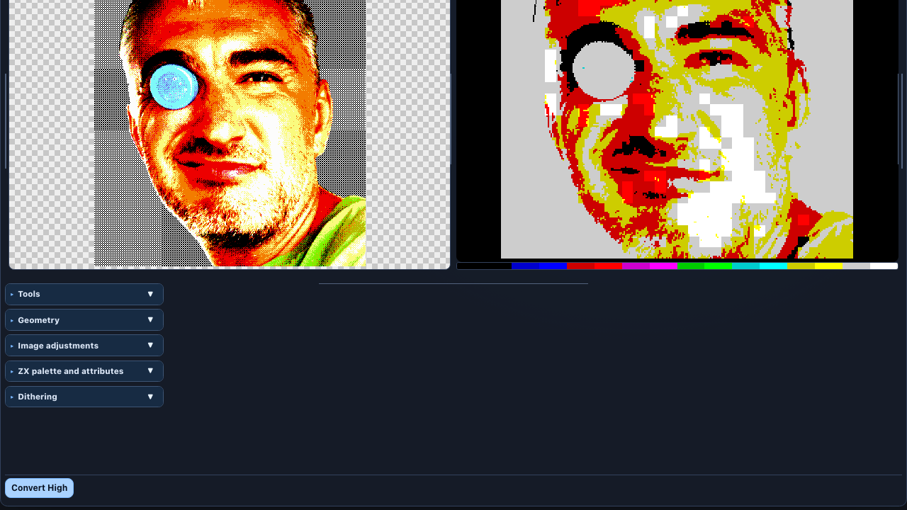 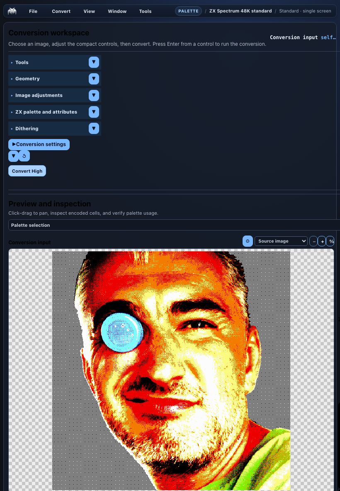 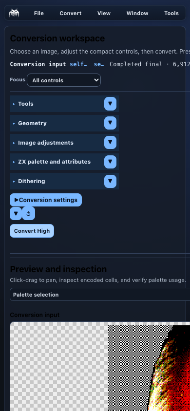
- 1280×720: document height 861 px → page scrolls; header scrolls out; the Convert button is the last element. Desktop workstation mode targets ≥1280 px wide *and* ≥850 px high (`13-desktop-workstation.css`).
- 820 px and 390 px: horizontal overflow (1601 / 1299 px). `Preview and inspection` select and Convert controls are clipped; "Conversion settings ▶", `▼`, `↻` are unlabeled blobs; the settings stack (five buttons) pushes the preview >1000 px down.
- ~35 `@media` rules are spread over 13 CSS files with breakpoints at 430/560/640/650/760/1000/1023/1279/1280 px — inconsistent.
- Fix: three layouts only (≥1100 guided desktop, 700–1099 stacked with sidebar as bottom sheet/tab, <700 single-column with tabs Source | Result | Settings); one breakpoint token set.

### F7 — Contrast, focus, accessibility (H / S)
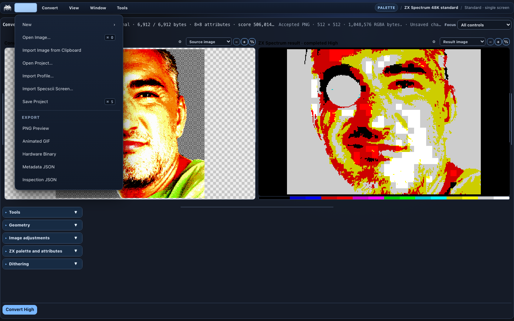 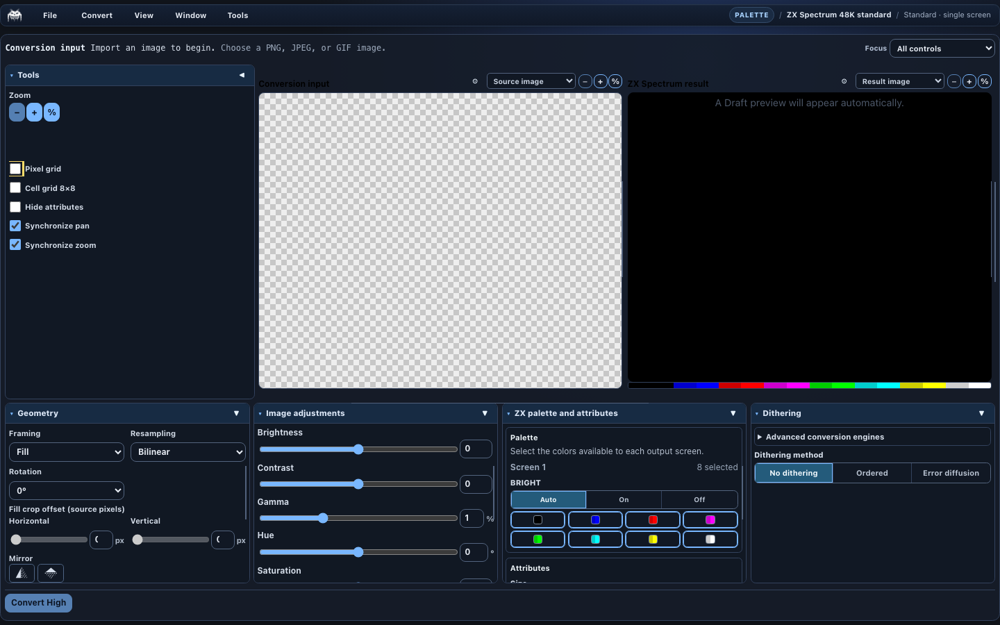
- Window titles (`Conversion input`, `ZX Spectrum result`) render dark on dark in [every desktop shot](screenshots/desktop-01-empty.png): effectively invisible (measure with axe; fix to ≥4.5:1).
- Open menu trigger ("File") loses its label (light fill, light text).
- Small type: 0.55–0.72 rem used 100+ times; body 12 px, label 11 px. Muted greys (`#9eabbd`, `#b8c9df`) on `#111824` should be audited; several grey-on-grey disabled states.
- Positives: skip link, tab order is sensible (Skip → About → menus → docks), visible yellow focus ring in settings, `prefers-reduced-motion` handled in 3 files, ARIA live regions in 9 files, menus keyboard-operable.
- Gaps: only `⌘O`, `⌘S`, `⌘,` shortcuts (`workbench-menu-bar.tsx`); no Convert/Export/Compare/Zoom shortcuts; no shortcut help; tab order enters the docks only after 12 stops; icon-only ± / % / ⊙ buttons need labels/tooltips beyond `aria-label`.

### F8 — Export is hidden (M / S)
- After conversion the user must know to open File. Add a primary **Export ▾** split button in the workflow bar (default: PNG Preview; menu: Hardware Binary/`.scr`, GIF, JSON), enabled only once a final result exists, with one-line descriptions.

### F9 — Preview comparison (M / M)
- Source and Result are two independent windows with their own zoom controls; sync is a checkbox in a collapsed "Tools" window. No swipe/flicker; difference heatmap only via dropdown; no pixel-peek readout in the default layout.
- Fix: a single compare stage with segmented control *Side by side · Swipe · Result only · Difference*, shared zoom/pan by default (single control set), per-window controls only in Advanced layout.

### F10 — Menu bar and workbench windows (M / M)
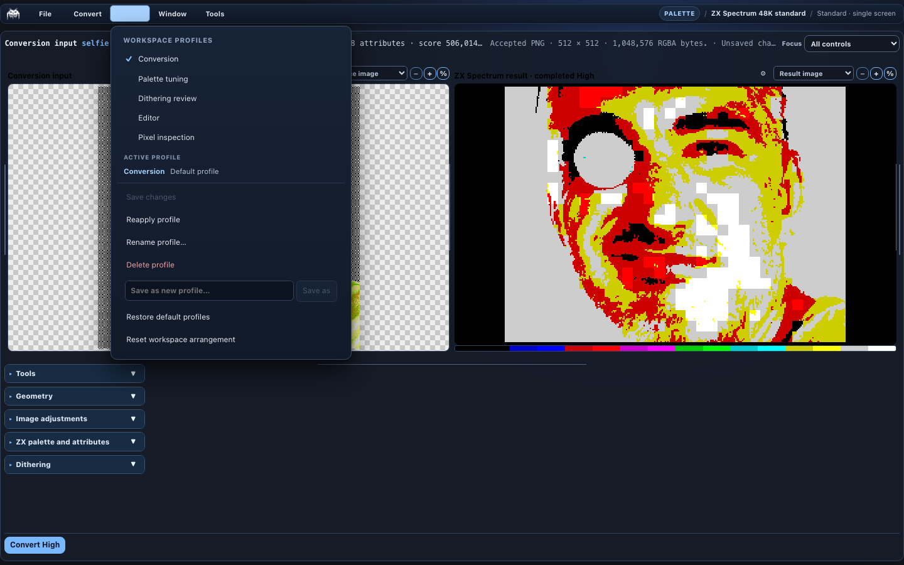 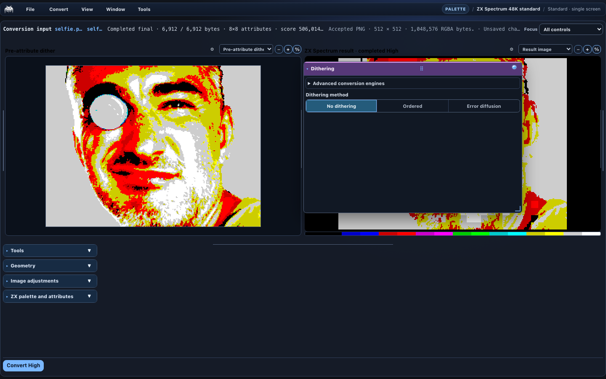
- Menu bar is conventional and consistent (File/Convert/View/Window/Tools) — keep; the "Settings" menu id exists in code but the visible item is Tools ▸ Application Settings (naming drift).
- Six layouts (Conversion, Palette tuning, Dithering review, Tilemap cleanup, Editor, Pixel inspection) are power features hidden in View; the default "Conversion" layout is the least guided. "Tilemap cleanup" is only offered in some profiles (my capture script found no such item for ZX standard) — fine, but menu state is not explained.
- Editors ([palette](screenshots/desktop-10-palette-editor.png), [bitmap](screenshots/desktop-09-result-bitmap-editor.png), [unified](screenshots/desktop-09-result-unified-editor.png)) are dense but coherent; they should be reachable from the Inspect step ("Edit result…") rather than only as dropdown contents.

### F11 — Typography, spacing, tokens (M / M)
- `01-tokens.css` has 8 colour tokens + 6 type tokens + 2 heights; 20 CSS files contain **~208 distinct hex colours**, ≥12 font-size values (0.55–0.82 rem) and ≥6 radii (0, .2, .25, .3, .35, .45 rem). No spacing, radius, z-index, elevation or breakpoint tokens.
- Mixed visual idioms: pill-shaped blue primary buttons (Convert High, mobile), square-ish windows, round ± buttons.
- Retro identity currently lives only in the mono status text and the invader logo; the palette strip under the result is the one distinctively ZX element. Opportunity: lean into it (ZX 8-colour accent stripe in the header, bitmap-style step numbers, mono numerals) without hurting legibility.

### F12 — What already works (keep)
Fast non-blocking import; auto draft preview; stale-result hint; descriptive settings with search/modified/disabled reasons; keyboard-operable menus with accelerators; layouts persistence; typography settings; zero console errors; the ZX palette strip.

## 4. Prioritised backlog (impact vs effort)

| # | Item | Impact | Effort | Quadrant |
| --- | --- | --- | --- | --- |
| 1 | Fix window-title / menu-trigger contrast (F7) | H | S | **Do now** |
| 2 | Empty-state drop zone + hints (F1) | H | S | **Do now** |
| 3 | Stop horizontal overflow; fit 1280×720 without page scroll (F6) | H | S–M | **Do now** |
| 4 | Visible Export button; Convert `⌘↵`, Export shortcut (F8, F7) | M | S | **Do now** |
| 5 | Settings tiers (`level` field) + sidebar (F3, F4) | H | M | Plan |
| 6 | Workflow bar with Target/Preset selects (F2) | H | M | Plan |
| 7 | Status bar + progress/cancel/error states (F5) | M | M | Plan |
| 8 | Unified compare stage (F9) | M | M | Plan |
| 9 | Responsive tabs layout ≤1099 px (F6) | M | M–L | Plan |
| 10 | Design tokens for spacing/radius/type/breakpoints, de-duplicate colours (F11) | M | L | Incremental |
| 11 | Retro polish (header stripe, step badges) | L | S | Later |

## 5. Proposal

### 5.1 Target workflow

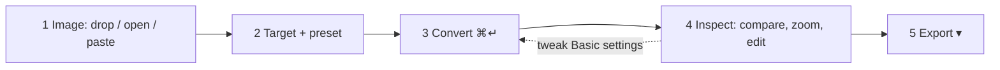

- One persistent **workflow bar** shows state: steps are *done / active / disabled*; Convert is the primary action; Export enables after a final result.
- Draft preview continues to update automatically on setting changes; "Convert" produces the final result; stale state is shown on the Convert button ("Convert — results out of date").
- Happy path: drop image (1) → pick target (0–1) → Convert (1) → Export (1–2). New users never need a menu.

### 5.2 Layout options

**A. Polish in place (workbench default).** Keep current docks; fix contrast, empty state, overflow, add Export button, wrap settings in tiers inside the existing Settings windows. *Pros:* lowest risk, smallest diff. *Cons:* workflow remains implicit; cramped windows stay; weak on tablet.

**B. Guided stage + settings sidebar (recommended).** Top workflow bar; centre compare stage (Side by side / Swipe / Result only / Difference, linked zoom); right sidebar with Basic/Advanced/Expert tiers (320 px, collapsible); footer status bar (result summary, progress + Cancel, project state). Existing dock layouts remain available from View ▸ "Workbench layouts" for Palette tuning, Dithering review, Editor, Pixel inspection. Mockup: [`mockups/recommended-layout.html`](mockups/recommended-layout.html) ([PNG](mockups/recommended-layout.png)). *Pros:* explicit workflow, clean default, fits 1280×720, maps to phone as tabs; reuses registry/hook state. *Cons:* new shell composition; two ways to arrange the UI to maintain.

**C. Wizard (stepper with separate pages).** Full-screen steps. *Pros:* simplest for novices. *Cons:* slows iterative tweak/convert/inspect loop, hides before/after during tweaks, contradicts the dock-based power features — not recommended.

### 5.3 Settings tiers (registry-driven)

Add `level` to `SettingDefinition` (default `"advanced"`), plus a persisted preference `settingsLevel` (application scope). Sidebar shows settings with `level <= selected`; the search and "Modified" filter always include everything and show the owning tier badge. A setting that is *modified* is always shown regardless of tier (avoids hidden state).

| Tier | Intent | Settings (from `settings-registry.ts`) |
| --- | --- | --- |
| **Basic** (≈6) | What 90 % of users change | Target/profile, preset, framing (fill/fit/crop/stretch), dithering mode, dithering amount, brightness, contrast, (zoom sync on/off in the stage, not the sidebar) |
| **Advanced** (≈20) | Looks and hardware tuning | Resampling, rotation, mirror, saturation/hue/gamma, ordered matrix, artistic pattern, palette enable/BRIGHT mode, attribute cell size, background, export zoom, GIF border options |
| **Expert** (rest, ≈35) | Engines, optimizers, diagnostics, UI | Advanced conversion engines, composer / custom matrices / kernels (readonly editors), optimizer settings, palette calibration, fill crop offsets, development mode (benchmarks, comparison, diagnostics), typography/appearance, mouse/workspace internals |

Application preferences (startup, appearance, workspace, mouse) stay in the Settings modal, not the sidebar; the sidebar shows only `scope: conversion` (and project) settings. Exact assignment is Open Question Q2.

### 5.4 Cross-cutting design rules

- **Tokens first:** add spacing (4/8/12/16/24), radius (0/4), type scale (11/12/14/16), elevation and breakpoint tokens to `01-tokens.css`; new CSS uses tokens only; migrate old files opportunistically.
- **Contrast:** ≥4.5:1 for text, ≥3:1 for control borders; minimum body text 12 px, labels ≥11 px; no <0.68 rem except decorative.
- **Retro identity:** keep navy/yellow/ZX-palette accents, mono numerals for data, stepped (non-rounded) 2–4 px radii, ZX 8-colour stripe in the header; avoid skeuomorphic CRT effects in the chrome.
- **Keyboard:** `⌘O` open, `⌘↵` convert, `⌘E` export, `⌘,` settings, `[`/`]` compare mode, `0` fit, `1` 100 %, `?` shortcut help; roving tabindex for the workflow bar.

## 6. Incremental implementation plan

Each step is independent and shippable, sized for one session. "Conflicts" lists steps that touch the same files and should not be developed in parallel.

| Step | Scope | Files (main) | Conflicts with |
| --- | --- | --- | --- |
| **S1 Contrast & focus fixes** | Window titles, open-menu trigger, muted greys, focus rings; add axe-style contrast check to smoke | `styles/02`, `03`, `05`, `20`, `01-tokens.css`; `tools/smoke-web.mjs` | S10 (tokens) |
| **S2 Empty state + drag/drop/paste hint** | Drop zone in source window, placeholder in result, hide checkerboard when no image | `App.tsx`, `app/sections/source-comparison-dock.tsx`, `result-comparison-dock.tsx`, `styles/10` | S6 |
| **S3 Fix overflow / 1280×720 fit** | Remove horizontal overflow ≤1000 px; make shell `100dvh` with internal scroll so header and Convert stay visible | `styles/13`, `16`, `17`, `20`, `03` | S8, S9 |
| **S4 Export button + shortcuts** | Primary Export ▾ (PNG default), `⌘↵` convert, `⌘E` export, shortcut help | `workbench-menu-bar.tsx`, `App.tsx`, `app/use-charset-and-export.ts`, styles/05 | S6 |
| **S5 Registry `level` + tests** | Add `level` to definitions, `settingsLevel` preference, selectors; no UI change | `settings-registry.ts`, `application-settings.ts`, `settings-registry.test.ts` | none (pure data) |
| **S6 Workflow bar** | Step bar with Target/Preset selects, Convert primary, Export; replaces breadcrumb | `App.tsx`, `workbench-menu-bar.tsx`, new `workflow-bar.tsx`, `app/use-conversion-settings.ts`, styles | S2, S4, S8 |
| **S7 Settings sidebar with tiers** (needs S5) | Basic/Advanced/Expert sidebar rendering registry controls; Basic first, Advanced/Expert reuse existing panels | new `settings-sidebar.tsx`, `app/use-settings-state.ts`, `app/use-workbench-windows.tsx`, styles/06,09,14 | S3, S8 |
| **S8 Status bar + progress/cancel/errors** | Footer with summary/progress/cancel/project state; error and cancelled states | `App.tsx`, `app/use-conversion-actions.ts`, `app/use-runtime-state.ts`, styles | S3, S6 |
| **S9 Unified compare stage** (needs S3) | Side by side / Swipe / Result only / Difference, linked zoom | `app/sections/*-comparison-dock.tsx`, `app/use-preview-sizing.tsx`, `use-preview-inspection.ts`, styles/10,16 | S3, S7 |
| **S10 Responsive tabs ≤1099 px** (needs S7, S9) | Source/Result/Settings tabs, bottom-sheet sidebar | styles/13,14,16,17, `App.tsx` | S3, S7, S9 |
| **S11 Token consolidation** (rolling) | Spacing/radius/type tokens, merge duplicate colours, breakpoint tokens | `styles/01…20` | S1 and everything touching CSS — do last or in slices per file |

Suggested order: S1 → S2 → S3 → S4 → S5 → S7 → S6 → S8 → S9 → S10 → S11. S1–S5 can be reviewed in parallel pairs as long as S1/S3 and S2/S4 do not share a branch.

Acceptance for the whole programme: smoke test passes at 1440×900, 1280×720 and 390×844 with no horizontal scroll; happy path ≤ 4 clicks from empty; axe reports no serious contrast violations on default layout.

## 7. Open questions

1. **Audience:** primarily newcomers converting a picture, or retro developers fine-tuning attributes? (Determines default tier and whether to ship Guided as default or opt-in at first.)
2. **Tier assignment:** is the Basic list (target, preset, framing, dithering mode/amount, brightness, contrast) right? Should palette BRIGHT/colour enables be Basic for ZX?
3. **Layouts:** can the six dock layouts move under View ▸ "Workbench layouts" and be called "Pro workspace", or must the current workbench stay the default?
4. **Zoom/pan sync default:** registry says on, UI showed it off in the Tools window — which is intended? Single shared zoom in Guided?
5. **"Convert High" vs Draft:** rename to "Convert" / "Final quality"? Should Draft be hidden from Basic users?
6. **Mobile scope:** is phone a supported target, or only "usable on tablet"? (Affects S10.)
7. **Retro styling:** how far to go — header ZX stripe and mono numerals only, or full pixel-font chrome (accessibility trade-off)?
8. **Other targets:** QL and PMD 85 profiles share the sidebar; confirm tiers should be per-profile via `isAvailable` rather than separate lists.
9. **Score:** keep exposing the optimiser score in the status line, or move to Expert/inspection?

## 8. Method notes and limits

- Screenshots generated with Playwright 1.65 (Chromium) against `vite dev`; capture script is based on `tools/smoke-web.mjs` states. States not reached: error banners (no failing input was supplied), PMD 85 / QL profiles, tilemap layout (not offered for the ZX standard mode).
- Contrast statements are visual; run axe/WebAIM measurements in S1 to confirm ratios.
- `design-qa.md` covers only the Settings typography preview; findings here do not contradict it. Feature docs 001–007 were consulted for intent (inspection workspaces, dockable windows, registry settings, menu bar); this proposal keeps those features and re-frames the default entry point.
